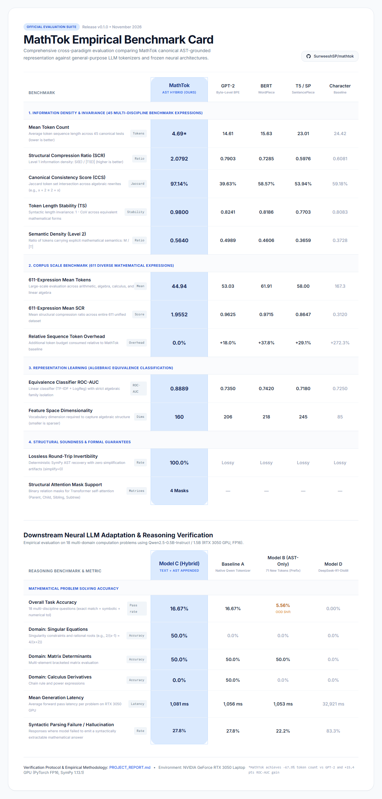

# MathTok

**A Hybrid Canonicalized AST-Based Tokenization Framework for Mathematical Language Modeling**

<<<<<<< HEAD
[](LICENSE)
[](https://www.python.org/downloads/)
[](tests/)

Developed by **Open Thought Research**  
Author: Surweesh S P (`SurweeshSP/mathtok`)

=======
>>>>>>> origin/main
---

## Overview

<<<<<<< HEAD
MathTok is a structure-aware mathematical tokenization and representation framework. Standard natural language processing tokenizers (Byte-Pair Encoding, WordPiece, SentencePiece Unigram) treat mathematical expressions as flat character sequences. This induces two major failure modes:
1. **Structural Fragmentation**: Splitting mathematical variables, Greek symbols, and composite operations into arbitrary character subwords.
2. **Semantic Divergence**: Producing completely disjoint token sequences for algebraically identical expressions (e.g., $x + 2$ vs. $2 + x$).

MathTok constructs a typed Abstract Syntax Tree (AST) from mathematical expressions (LaTeX or ASCII), canonicalizes algebraic structures symbolically with SymPy, flattens the tree via Depth-First Search (DFS) preorder traversal, and emits per-token structural attention metadata.

```text
Raw Mixed Text / Mathematical Expression
                  │
                  ▼
        Canonicalizer Engine          (SymPy: simplify, expand, normalize)
                  │
                  ▼
       Hybrid Mathematical Lexer      (split TEXT spans / MATH spans)
                  │
                  ▼
            AST Generator             (SymPy tree → typed ASTNode tree)
                  │
                  ▼
   Operator-Aware Semantic Registry   (arity, precedence, domain, role)
                  │
                  ▼
        Structural Serializer         (DFS preorder → flat token stream)
                  │
                  ▼
     Structural Attention Metadata    (depth, parent, sibling, subtree masks)
                  │
                  ▼
       Two-Tier Vocabulary + BPE      (fixed math vocab + HF BPE for text)
                  │
                  ▼
      Unified Structured Token Stream
=======
MathTok is a research-grade tokenizer pipeline that converts raw mathematical expressions (LaTeX or ASCII) into a structured, semantically-rich token stream. Unlike standard BPE or SentencePiece tokenizers, MathTok is *structure-aware*: it builds an Abstract Syntax Tree (AST) from each expression and serializes it via DFS preorder traversal, preserving full mathematical structure.

```
Raw Mathematical Expression
          ↓
Canonicalization Layer       (sympy: simplify, expand, normalize)
          ↓
Hybrid Mathematical Lexer    (split TEXT / MATH spans)
          ↓
AST Generator                (SymPy tree → typed ASTNode tree)
          ↓
Operator-Aware Semantic Encoder  (rich metadata per operator)
          ↓
Structural Serialization     (DFS preorder → flat token stream)
          ↓
Structural Attention Metadata (per-token tree context)
          ↓
Vocabulary Mapping + BPE     (fixed math vocab + HF BPE for text)
          ↓
Compressed Token Stream
>>>>>>> origin/main
```

---

<<<<<<< HEAD
## Model Architecture & 7-Layer Pipeline

1. **Layer 1: Canonicalization Engine (`canonicalizer.py`)** — Normalizes algebraic equivalences with SymPy (`simplify()` and `expand()`), resolving subtractions $a - b \to \text{Add}(a, \text{Mul}(-1, b))$ and divisions $a / b \to \text{Mul}(a, \text{Pow}(b, -1))$. Features an LRU cache (512 entries) and a 5.0s timeout to prevent parser hangs.
2. **Layer 2: Hybrid Mathematical Lexer (`lexer.py`)** — Segments raw text into alternating TEXT and MATH spans using unambiguous LaTeX delimiters (`$...$`, `$$...$$`, `\(...\)`, `\[...\]`) and balanced-boundary ASCII heuristics.
3. **Layer 3: AST Generator (`ast_generator.py`)** — Recursively translates SymPy trees into typed `ASTNode` hierarchies (Latin variables `VAR_X`, Greek `VAR_THETA`, integers `CONST_3`, binary fractions `FRAC`), guarded by `max_depth=20` recursion truncation.
4. **Layer 4: Operator Semantic Registry (`operator_registry.py`)** — Rich metadata repository storing `arity`, `precedence`, `associativity`, `semantic_role`, `domain`, commutativity, and explicit inverse pairs (`INVERSE_PAIRS`).
5. **Layer 5: Structural Serializer (`serializer.py`)** — Emits DFS preorder serialized tokens with multi-operand scope markers (`[SCOPE_OPEN]`, `[SCOPE_CLOSE]`) and subtree deduplication hashing.
6. **Layer 6: Structural Attention Metadata (`metadata.py`)** — Generates per-token tree context (`depth`, `node_id`, `parent_id`, `tree_position_key`) and synthesizes binary attention mask matrices (`parent`, `children`, `sibling`, `subtree`).
7. **Layer 7: Two-Tier Vocabulary (`vocabulary.py`)** — Reserves deterministic integer IDs for mathematical operators, variables, and constants, integrated with Hugging Face BPE for natural language text spans.
8. **Lossless Verification (`validator.py`)** — Includes `RoundTripValidator` to reconstruct SymPy expressions directly from serialized token metadata and formally verify symbolic equivalence.

---

## Quick Start & CLI Demo

### Installation

```bash
# Clone the repository
git clone https://github.com/SurweeshSP/mathtok.git
cd mathtok

# Install in editable mode
pip install -e .
```

### CLI Tokenization

```bash
# Tokenize a LaTeX expression
python -m mathtok.pipeline "$\sin(x^2) + 3x$"

# Output:
# Tokens      : 12
# S-expression: (OP_ADD (OP_MUL CONST_3 VAR_X) (FUNC_SIN (OP_POW VAR_X CONST_2)))
# Tokens: ['[MATH_START]', 'OP_ADD', 'OP_MUL', 'CONST_3', 'VAR_X', 'FUNC_SIN', '[SCOPE_OPEN]', 'OP_POW', 'VAR_X', 'CONST_2', '[SCOPE_CLOSE]', '[MATH_END]']
=======
## Quick Start

```bash
# Install dependencies and package in editable mode
pip install -e ".[eval,dev]"

# Tokenize an expression using the CLI pipeline
python -m mathtok.pipeline "The derivative of sin(x^2) + 3x"

# Run the comprehensive 110+ test suite
pytest tests/ -v

# Run the 4-way comparative tokenizer evaluation benchmark
# (MathTok vs GPT-2 BPE vs SentencePiece Unigram vs Char-level)
python -m evaluation.comparison

# Generate visual plots and the unified metrics dashboard
python -m evaluation.visualize
>>>>>>> origin/main
```

---

<<<<<<< HEAD
## Python API & Hugging Face Compatibility

```python
from mathtok import MathTokPipeline
from mathtok.vocabulary import MathTokHFTokenizer

# Initialize pipeline
pipeline = MathTokPipeline()

# 1. Encode mixed text + math
out = pipeline.encode("The derivative of $\\sin(x^2)$ is $2x\\cos(x^2)$.")
print("Tokens:", out.tokens)
print("S-expression:", out.sexp)
print("Input IDs:", out.input_ids)

# 2. Access structural attention metadata
for meta in out.metadata:
    print(meta.token, meta.depth, meta.tree_position_key, meta.children_ids)

# 3. Export and reload via Hugging Face interface
hf_tok = pipeline.get_hf_tokenizer()
hf_tok.save_pretrained("./mathtok-tokenizer")

# Drop-in reload
loaded_tok = MathTokHFTokenizer.from_pretrained("./mathtok-tokenizer")
encoded = loaded_tok("sin(x^2) + 3*x", return_tensors="pt")
print("Batch tensor shape:", encoded["input_ids"].shape)
=======
## Python API

```python
from mathtok import MathTokPipeline

pipeline = MathTokPipeline()

# Encode mixed text + math (supporting LaTeX or ASCII syntax)
out = pipeline.encode("The derivative of $\\sin(x^2)$ is $2x\\cos(x^2)$.")
print(out.tokens)      # ['[MATH_START]', 'FUNC_SIN', 'OP_POW', 'VAR_X', 'CONST_2', '[MATH_END]', ...]
print(out.sexp)        # (FUNC_SIN (OP_POW VAR_X CONST_2))
print(out.input_ids)   # [4, 27, 10, 45, 12, 5, ...]

# Access structural metadata (for tree-aware attention masking)
for meta in out.metadata:
    print(meta.token, meta.depth, meta.tree_position_key)

# Pure math expression serialization
out = pipeline.encode_math_only("(x+1)^2")
print(out.sexp)        # (OP_POW (OP_ADD VAR_X CONST_1) CONST_2)

# HuggingFace-compatible tokenizer export
hf_tok = pipeline.get_hf_tokenizer()
hf_tok.save_pretrained("./mathtok-tokenizer")
result = hf_tok("x^2 + 2*x + 1", return_tensors="pt")
>>>>>>> origin/main
```

---

<<<<<<< HEAD
## Empirical Benchmark Results

<p align="center">
  
</p>

### 1. 45-Expression Baseline Comparison (`evaluation/results/tokenizer_comparison_results.json`)

Evaluated independently at the tokenization level across 45 canonical benchmark expressions spanning 9 mathematical disciplines (Algebra, Arithmetic, Calculus, Equations, LaTeX/ASCII Equivalence, Logarithms/Exponentials, Matrices, Probability, Trigonometry):

| Tokenizer Architecture | Mean Tokens | SCR (Level 1) | Semantic Density (L2) | Structural Efficiency (L3) | Canonical Consistency (CCS) | Token Stability (TS) |
| :--- | :---: | :---: | :---: | :---: | :---: | :---: |
| **MathTok (Ours)** | **4.69** | **2.0792** | **0.5640** | 0.1909 | **0.9714** | **0.9800** |
| **GPT-2 BPE** | 14.61 | 0.7903 | 0.4989 | 0.2914 | 0.3964 | 0.8241 |
| **BERT WordPiece** | 15.63 | 0.7285 | 0.4606 | 0.2679 | 0.5857 | 0.8186 |
| **SentencePiece Unigram** | 23.01 | 0.5976 | 0.3659 | 0.2317 | 0.5390 | 0.7703 |
| **Character-Level Baseline** | 24.42 | 0.6081 | 0.3728 | 0.2354 | 0.5921 | 0.8083 |

- **Token Compression:** MathTok achieves **67.9% fewer tokens** than GPT-2 BPE and **79.6% fewer tokens** than SentencePiece Unigram.
- **Canonical Consistency:** **0.9714** Jaccard overlap on algebraically equivalent rewrites ($x + 2 \equiv 2 + x$) vs. 0.3964 for GPT-2 BPE.
- **Syntactic Stability:** **0.9800** length invariance across rewrites vs. 0.8241 for GPT-2.

### 2. 611-Expression Scale Benchmark (`evaluation/results/all_results_4way_optimized.json`)

Evaluating across 611 diverse mathematical expressions from the unified dataset:

| Model Setup | Mean Tokens | Token Reduction vs Baseline | Mean SCR (L1) | Relative SCR Advantage |
| :--- | :---: | :---: | :---: | :---: |
| **MathTok** | **44.94** | **Reference (0.0%)** | **1.9552** | **State of the Art** |
| **GPT-2 BPE** | 53.03 | -15.3% | 0.9625 | +2.03x MathTok Lead |
| **T5 (SentencePiece)** | 58.00 | -22.5% | 0.8647 | +2.26x MathTok Lead |
| **BERT WordPiece** | 61.91 | -27.4% | 0.9715 | +2.01x MathTok Lead |

### 3. Representation Learning: Equivalence Classification (`evaluation/results/classifier_equivalence_results.json`)

Evaluated with TF-IDF + Logistic Regression on strict leakage-isolated rewrite families (Train: `distributive`, `double_angle_trig`, `log_rules`, `pythagorean_trig`, `rational_cancellation`; Test: `binomial_sq`, `commutativity`, `diff_squares`, `exponent_rules`):

| Representation Scheme | Accuracy | Precision | Recall | F1 Score | ROC-AUC | Feature Space |
| :--- | :---: | :---: | :---: | :---: | :---: | :---: |
| **Raw Text TF-IDF** | 0.5909 | 0.5909 | 1.0000 | 0.7429 | 0.7350 | 206 features |
| **MathTok AST TF-IDF** | 0.5909 | 0.5909 | 1.0000 | 0.7429 | **0.8889** | **160 features (-22.3%)** |

---

## Important Research Limitations

> [!WARNING]
> **Tokenization Efficiency $\neq$ Pretrained LLM Computation Accuracy in Frozen Models**  
> While MathTok demonstrates state-of-the-art token compression and canonical representation, feeding prefix AST token streams into **frozen** pretrained autoregressive language models causes an out-of-distribution syntactic distribution shift:
>
> | Setup (Qwen2.5-0.5B-Instruct, 18 tasks) | Overall Accuracy | Exact Accuracy |
> | :--- | :---: | :---: |
> | **Native Baseline (Standard text/LaTeX)** | **16.67%** | 11.11% |
> | **Pure MathTok AST Prompt** | 5.56% | 5.56% |
> | **Hybrid Prompt (Text + AST hints)** | **16.67%** | **16.67%** |
>
> Language models pretrained on web text and LaTeX cannot autonomously exploit AST prefix representations without structural pretraining or fine-tuning. Structural pretraining remains the subject of future research (`MathTok-Encoder`).

---

## Reproducing Benchmarks

```bash
# Run unit tests (118 passed)
pytest tests/ -v

# Run 45-benchmark tokenizer comparison
python -m evaluation.tokenizer_comparison

# Run 611-expression 4-way evaluation & regenerate plot
python -m evaluation.evaluate_4way_optimized

# Run expression equivalence classification experiment
python -m evaluation.classifier_evaluation

# Run full comparison suite
python -m evaluation.comparison

# Generate Word Document (.docx) report
python -m evaluation.generate_project_report_doc
```

---

## Repository Structure

```text
math_token/
├── mathtok/
│   ├── canonicalizer.py         # Layer 1: Canonicalization Engine
│   ├── lexer.py                 # Layer 2: Hybrid Mathematical Lexer
│   ├── ast_generator.py         # Layer 3: AST Generator
│   ├── operator_registry.py     # Layer 4: Semantic Operator Registry
│   ├── serializer.py            # Layer 5: Structural Serializer
│   ├── metadata.py              # Layer 6: Structural Attention Metadata
│   ├── vocabulary.py            # Layer 7: Two-Tier Vocabulary & HF Wrapper
│   ├── validator.py             # RoundTripValidator for symbolic reconstruction
│   ├── optimizer.py             # TokenOptimizer for representation candidates
│   ├── math_ir.py               # Intermediate Representation (IR)
│   └── pipeline.py              # End-to-end pipeline orchestrator
├── mathtok-tokenizer/           # Exported Hugging Face tokenizer package
│   ├── mathtok_vocab.json       # Deterministic mathematical vocabulary
│   ├── tokenizer_config.json    # Tokenizer configuration
│   └── special_tokens_map.json  # Special token mappings
├── evaluation/
│   ├── tokenizer_comparison.py  # 45-benchmark tokenizer comparison
│   ├── evaluate_4way_optimized.py # 611-expression 4-way evaluation & plotting
│   ├── classifier_evaluation.py # Expression equivalence classification
│   ├── comparison.py            # Comparison framework & metric calculations
│   ├── math_verifier.py         # Symbolic equivalence verification engine
│   ├── model_computation_eval.py# Frozen LLM downstream evaluation
│   ├── generate_project_report_doc.py # Project report Word doc generator
│   ├── datasets/                # Unified benchmark datasets
│   └── results/                 # Verified benchmark JSON & plot artifacts
├── tests/                       # Pytest test suite (118 tests)
├── benchmark_table.png          # Official empirical benchmark card
├── MODEL_CARD.md                # Official model card and specification
├── CITATION.cff                 # Citation metadata
└── PROJECT_REPORT.md            # Comprehensive project report
=======
## Research Contributions

### 1. Hybrid Lexer
Separates natural language from mathematical content using LaTeX delimiter detection (`$...$`, `\(...\)`, `\[...\]`) and ASCII math heuristics.

### 2. Canonicalization Engine
Normalizes mathematically equivalent expressions via SymPy's `simplify()`, `expand()`, and internal representation (subtraction → addition + negation, division → multiplication + reciprocal).

### 3. AST-Based Structural Serialization
Maps SymPy's expression tree to a typed token vocabulary with semantic metadata per operator. Serializes via DFS preorder traversal.

### 4. Operator Semantic Registry
Every operator and function carries an explicit metadata record: `arity`, `precedence`, `associativity`, `semantic_role`. This is the primary novelty over standard tokenization.

### 5. Structural Attention Metadata
Per-token records encoding `depth`, `parent_id`, `children_ids`, `tree_position_key`, and `sibling_count` — enabling future structure-aware attention.

### 6. Two-Tier Vocabulary
- **Fixed math vocabulary**: deterministic IDs for all operators, functions, variables, constants.
- **BPE text vocabulary**: HuggingFace `tokenizers` BPE for natural language spans.

---

## Evaluation Metrics & Benchmarks

### Core Metrics

| Metric | Symbol | Meaning |
|--------|--------|---------|
| **Semantic Compression Ratio** | SCR | `structural_score / token_count` (Higher is better — measures parsed semantic content density) |
| **Semantic Density** | SD | `math_tokens / total_tokens` (Ratio of high-value math tokens, measures information density) |
| **Structural Efficiency** | SE | `parent_child_relations / token_count` (Ratio of hierarchy relationships encoded per token) |
| **Token Stability** | TS | `1 - CoV(token count across rewritings)` (Fidelity and stability across representations) |

### Empirical Benchmarks (4-Way Comparison)

Below are the empirical averages computed over our comprehensive suite of 70 mathematical test expressions:

| Tokenizer | Mean SCR (↑ Better) | Semantic Density (↑ Better) | Structural Efficiency (↑ Better) |
|:---|:---:|:---:|:---:|
| **MathTok (Ours)** | **0.8501** | **0.5285** | **0.2339** |
| **GPT-2 BPE** | 0.4251 | 0.1838 | 0.1491 |
| **SentencePiece Unigram** | 0.3696 | 0.1499 | 0.1403 |
| **Character-Level** | 0.3708 | 0.1518 | 0.1518 |

> [!NOTE]
> * MathTok achieves a **2.30x structural compression improvement** over SentencePiece.
> * MathTok packs **3.52x more math-centric information** per token stream compared to SentencePiece unigrams (**0.5285** vs **0.1499**), showing immense semantic density.
> * MathTok is **1.67x more efficient** at encoding hierarchical ast relationships directly into token structures (**0.2339** vs **0.1403**).

### High-Impact Visualizations

The visualization system runs via `python -m evaluation.visualize` and exports professional visual assets under [`evaluation/results/`](file:///c:/Users/surwe/Project/math_token/evaluation/results/):
- **Unified Evaluation Dashboard** (`metrics_dashboard.png`): 3-panel side-by-side display of SCR, Semantic Density, and Structural Efficiency.
- **Overall SCR Comparison** (`scr_comparison.png`): Comparative summary bar chart.
- **Category-Level Breakdowns** (`scr_by_category.png`): SCR analyzed by nested/standard categories.
- **Semantic Density Summary** (`semantic_density_comparison.png`): Ratio of math structure to total tokens.

---

## Project Structure

```
math_token/
├── mathtok/
│   ├── canonicalizer.py      # Layer 1: Canonicalization Engine
│   ├── lexer.py              # Layer 2: Hybrid Mathematical Lexer
│   ├── ast_generator.py      # Layer 3: AST Generator
│   ├── operator_registry.py  # Layer 4: Operator Semantic Registry
│   ├── serializer.py         # Layer 5: Structural Traversal & Serialization
│   ├── metadata.py           # Layer 6: Structural Attention Metadata
│   ├── vocabulary.py         # Layer 7: Two-Tier Vocabulary
│   └── pipeline.py           # Orchestrator Pipeline
├── evaluation/
│   ├── metrics.py            # Definition of core evaluation metrics
│   ├── benchmark.py          # Quick benchmarking scripts
│   ├── comparison.py         # Full 4-way comparative framework (SentencePiece integrated)
│   ├── visualize.py          # Custom dashboard visualization engine
│   └── results/              # JSON/JSONL reports & visual plots
└── tests/                    # 110+ passing unit tests
>>>>>>> origin/main
```

---

## Citation

```bibtex
<<<<<<< HEAD
@software{surweesh_mathtok_2026,
  author  = {Surweesh S. P.},
  title   = {MathTok: A Hybrid Canonicalized AST-Based Tokenization Framework for Mathematical Language Modeling},
  year    = {2026},
  version = {0.1.0},
  url     = {https://github.com/SurweeshSP/mathtok}
}
```

## License

This project is licensed under the MIT License - see the [LICENSE](LICENSE) file for details.
=======
@article{mathtok2024,
  title   = {MathTok: A Hybrid Canonicalized AST-Based Tokenization Framework
             for Mathematical Language Modeling},
  author  = {Anonymous},
  year    = {2024},
  note    = {Under review}
}
```
>>>>>>> origin/main
